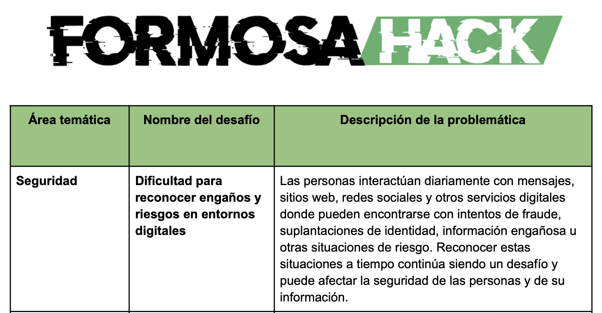

# 🛡️ Escudo Digital — Ecosistema de Prevención de Estafas Digitales

**FormosaHack 2026** — Solución integral e innovadora a la problemática de Seguridad y Ciberdelito orientada prioritariamente a adultos mayores y a la comunidad.

Desarrollado para el **Hackathon Formosa 2026** por **DuoPrograming** (*Guillermo A. Diarte & Leticia Uliambre*).

---

## 🎯 El Desafío — Problemática del Hackathon



> 📥 **[Descargar Presentación del Proyecto (PowerPoint .ppsx)](docs/assets/PresentacionEscudoiDgital.ppsx)**

---

## 📌 Propósito y Visión

**Escudo Digital** es un ecosistema colaborativo y preventivo diseñado para proteger a usuarios frente a fraudes telefónicos, estafas por WhatsApp/SMS, suplantación bancaria y enlaces de phishing.

### Principios Fundamentales
1. **Protección Activa en Segundo Plano**: Monitorea de forma automática llamadas, mensajes y navegación web sin exigir al adulto mayor copiar/pegar textos ni comprender términos técnicos complejos.
2. **Privacidad por Diseño**: No almacena conversaciones privadas ni accede al historial completo de chats; únicamente evalúa señales contextuales (remitente, número telefónico, enlaces web y patrones de urgencia/dinero).
3. **Funcionamiento 100% Offline**: El dispositivo Android cuenta con su propia base local (Room) y motor heurístico de riesgo, protegiendo al usuario aun sin conexión a Internet.
4. **Sincronización Incremental Eficiente**: Actualizaciones por deltas de versión (`v1`, `v2`, etc.) que cuidan la batería y el consumo de datos móviles del usuario.
5. **Ecosistema Abierto y Colaborativo**: Portal web ciudadano para reportar intentos de estafa, panel de moderación con detección de amenazas duplicadas y API pública abierta.

---

## 💻 ¿Qué es el Frontend, Backend y Mobile?

* **Frontend (Portal Web en `web/`)**: Es la interfaz gráfica con la que interactúan los ciudadanos y moderadores en el navegador. Aquí los usuarios buscan si un número o enlace es riesgoso, cargan denuncias con evidencia fotográfica y los moderadores validan los reportes.
* **Backend (Servidor API en `backend/`)**: Es el "cerebro" y servidor central. Gestiona la lógica de negocio, persiste los datos en la base central, valida la integridad de los reportes y provee los endpoints REST para la web y la app móvil.
* **Mobile (App Nativa en `android/`)**: Es la aplicación nativa para celulares que acompaña al ciudadano en su vida diaria, actuando como escudo protector directamente sobre llamadas, mensajes y navegación web.

---

## 🛠️ Tecnologías Utilizadas por Módulo

### 1. 📱 Módulo Android (Aplicación Móvil Nativa — `android/`)
* **Kotlin 1.9+**: Lenguaje de programación moderno, tipado y seguro para el desarrollo nativo en Android.
* **Android SDK 34 (Android 14)**: Compatibilidad con las últimas políticas y APIs de seguridad del sistema operativo.
* **Jetpack Room Database (SQLite Local)**: Motor de persistencia local 100% offline para almacenamiento de la base comunitaria de amenazas y listas de confianza personales.
* **Jetpack WorkManager**: Ejecución de tareas en segundo plano para sincronización periódica e incremental con la API central.
* **Arquitectura MVVM & Repository Pattern**: Separación clara de responsabilidades, Coroutines y Flow para concurrencia reactiva.
* **CallScreeningService**: Servicio de telefonía nativo para identificar e interceptar llamadas entrantes sospechosas antes o durante el timbre.
* **NotificationListenerService**: Interceptor de notificaciones entrantes de mensajería (WhatsApp, SMS) para análisis heurístico inmediato.
* **AccessibilityService (`ScamBrowserProtectionService`)**: Servicio de accesibilidad para inspección de URLs en navegadores (Google Chrome) y detección en tiempo real de sitios de phishing.
* **WindowManager / System Alert Window**: Despliegue de alertas modales prioritarias que se superponen a cualquier app para advertir de forma clara con preguntas de seguridad simples.
* **ADB & Netcat / Telnet**: Herramientas de automatización para pruebas y simulación de llamadas y mensajes en emuladores.

### 2. ⚙️ Módulo Backend (API REST & Lógica Central — `backend/`)
* **Python 3.10+ / 3.12**: Lenguaje base para el desarrollo del servidor y utilitarios de datos.
* **FastAPI**: Framework web asíncrono (ASGI) de altísimo rendimiento para APIs REST.
* **Uvicorn**: Servidor ASGI de nivel de producción optimizado para alta concurrencia.
* **SQLAlchemy 2.0**: ORM moderno para modelado de datos relacionales, transacciones y consultas avanzadas.
* **SQLite / PostgreSQL**: Persistencia de datos de amenazas, tipos de estafas, reportes ciudadanos, auditoría y versiones de sincronización.
* **Pydantic v2**: Validación estricta de esquemas, parsing de payloads y serialización de datos de entrada y salida.
* **Alembic**: Control de versiones y migraciones de esquemas de base de datos.
* **Pytest**: Suite de pruebas unitarias y de integración automatizadas.
* **OpenAPI (Swagger UI & ReDoc)**: Documentación viva e interactiva generada automáticamente en `/docs`.

### 3. 🌐 Módulo Web (Frontend & Panel de Moderación — `web/`)
* **Next.js 16 (App Router & Turbopack)**: Framework React de última generación para renderizado rápido y arquitectura de componentes moderna.
* **React 19**: Biblioteca fundamental para interfaces interactivas y reactivas.
* **TypeScript**: Tipado estático integral para máxima robustez y prevención de errores.
* **Tailwind CSS v4**: Estilizado moderno, variables CSS nativas, temas oscuros y estética premium con *Glassmorphism*.
* **Lucide React**: Set de iconografía vectorial limpia, accesible y consistente.
* **Canvas-Confetti**: Microinteracciones dinámicas y feedback visual en acciones del usuario.

---

## 🏗️ Estructura del Repositorio

```text
FormosaHack/
├── backend/            # FastAPI + SQLite/PostgreSQL (Base Central, API Pública, Sync Móvil)
│   ├── app/
│   │   ├── api/v1/     # Endpoints: /threats, /reports, /scam-types, /mobile/sync, /stats
│   │   ├── core/       # Configuración y conexión de BD
│   │   ├── models/     # Modelos SQLAlchemy (Threat, ScamType, Report, SyncState)
│   │   ├── schemas/    # Validación Pydantic v2
│   │   └── seeds/      # Casos reales de estafas en Argentina (ANSES, Mercado Pago, etc.)
│   ├── tests/          # Suite de pruebas automatizadas
│   └── run.sh          # Script de arranque del backend
├── web/                # Next.js 16 + TypeScript + Tailwind (Frontend: Portal Ciudadano & Admin)
│   ├── src/app/        # App Router, Layout y Páginas (Home, Admin)
│   ├── src/components/ # Buscador de Amenazas, Reportes, Moderador y API Explorer
│   ├── src/services/   # Conexión con Backend y validaciones en vivo
│   └── run.sh          # Script de arranque del frontend
└── android/            # App Nativa Android (Kotlin + Jetpack Room + Servicios del Sistema)
    ├── app/src/main/   # Código Kotlin (Services, UI, DB Room, Engine Heurístico)
    ├── test_emulator.sh# Script integral de pruebas y simulación ADB
    └── README.md       # Guía detallada del módulo móvil
```

---

## 🚀 Cómo Ejecutar el Proyecto

### 1. Iniciar el Backend (API)
```bash
cd backend
./run.sh
```
* **API Base:** `http://localhost:8000`
* **Swagger Docs:** `http://localhost:8000/docs`
* **Tests:** `./venv/bin/pytest -v`

### 2. Iniciar el Portal Web (Frontend)
```bash
cd web
./run.sh
```
* **Portal Web Ciudadano:** `http://localhost:3000`
* **Panel de Moderación:** `http://localhost:3000/admin`

---

## 📱 Pruebas en el Emulador Android (`test_emulator.sh`)

Para probar la aplicación móvil de manera ágil sin requerir dispositivos físicos ni llamadas reales, el proyecto incluye un script de automatización mediante **ADB** y la consola del emulador: `android/test_emulator.sh`.

### Prerrequisitos
1. Tener el emulador de Android Studio abierto y en ejecución (ej. Pixel 6 con API 31+).
2. Tener la app de **Escudo Digital** instalada en el emulador.

### Paso 1: Configurar permisos iniciales
Ejecutar **una sola vez** después de instalar la app para conceder los roles y permisos del sistema necesarios (notificaciones, screening de llamadas, accesibilidad para navegadores y ventana sobre otras apps):

```bash
cd android
./test_emulator.sh setup
```

### Paso 2: Ejecutar los comandos de prueba

El script ofrece comandos específicos para simular cada tipo de incidente:

```bash
# Simular llamada entrante sospechosa (Suplantación Bancaria)
./test_emulator.sh call "+5493704048860"

# Simular llamada perdida desde número reportado (Falso ANSES)
./test_emulator.sh missed "+5491140028899"

# Enviar SMS sospechoso de phishing al emulador
./test_emulator.sh sms "+5493517894561" "Estimado cliente: su cuenta fue bloqueada. Ingrese a http://banco-seguro-arg.site"

# Simular notificación de WhatsApp con intento de estafa "Cuento del Tío / Familiar"
./test_emulator.sh notif

# Abrir sitio de phishing en Google Chrome del emulador (activará el modal de intercepción web)
./test_emulator.sh url "http://anses-beneficios-gob-ar.site"

# Forzar sincronización inmediata de la base de datos local con el backend
./test_emulator.sh sync

# Observar los logs del motor de seguridad y servicios en tiempo real
./test_emulator.sh logs
```

### Paso 3: Demo Completa Automática para el Jurado
Para realizar una demostración completa paso a paso ante el jurado del Hackathon:

```bash
./test_emulator.sh demo
```
Este comando ejecuta una secuencia guiada que simula sucesivamente:
1. SMS de phishing bancario.
2. Llamada entrante de falso organismo público.
3. SMS urgente de falso familiar solicitando transferencia.
4. Navegación a URL maliciosa en Chrome con intercepción en vivo.

---

## 👥 Equipo de Desarrollo

* **Equipo:** DuoPrograming
* **Integrantes:** Guillermo A. Diarte & Leticia Uliambre
* **Evento:** Hackathon Formosa 2026 / FormosaHack 2026
